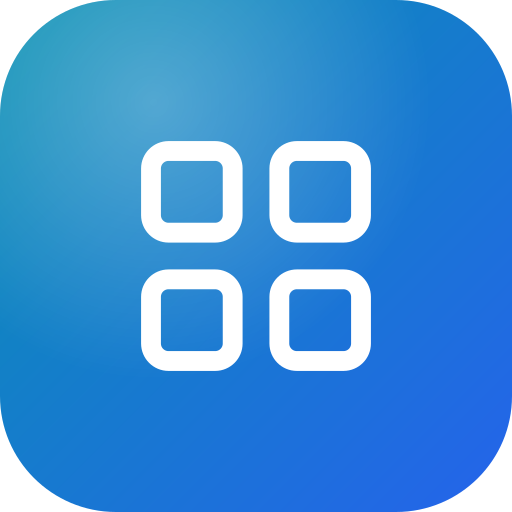

<p align="center"></p>

<h1 align="center">MKQ Web Tools Hub</h1>

<p align="center">
  A single home page for my web tools and side projects, in Arabic and English.<br>
  <sub>بوابة واحدة لأدواتي ومشاريعي على الويب، بالعربية والإنجليزية</sub>
</p>

<p align="center">
  
  
  
</p>

## What's inside

- **Tools section** linking to the projects it hosts (prompts library, Dhikra, Linkoo and more on `*.mkq.one`).
- **Arabic / English toggle** with right-to-left layout for Arabic.
- **Animated hero** — particle background and a 3D MKQ cube.
- **Privacy policy and terms** pages.

## Run locally

```bash
npm install
npm run dev          # http://localhost:8080
npm run build        # outputs to dist/
npm test             # vitest
```

Deployed to Firebase Hosting (`firebase.json`).

---

<p align="center"><sub>A hobby project by <a href="https://github.com/mkjq">@mkjq</a></sub></p>
